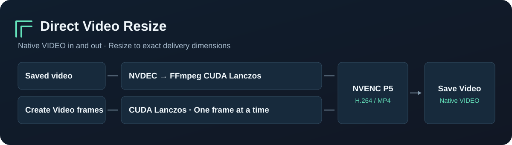

# Direct Video Resize for ComfyUI

**Give your render its delivery resolution.** Connect a native `VIDEO` to the node, enter a width and height, then send the resized video to `Save Video`.

[简体中文](README.zh-CN.md) · [Benchmark and test method](docs/BENCHMARKS.md) · [Example workflow](workflows/resize-saved-video.json)



### Why use it?
+- **Deliver a high-resolution render at 1080p.** Put this node after `Create Video` in an H3, VAE decode, or video super-resolution workflow. It reads the existing frames, downsizes each frame with antialiased CUDA Lanczos, and sends the result to the H.264 encoder. The first video encode happens at the delivery resolution.
- **Resize a saved clip without building an image batch.** For compatible, same-aspect-ratio files, FFmpeg uses NVDEC, `scale_cuda` with Lanczos, and NVENC. The node copies compatible audio streams and passes the source frame timing through.
- **Keep working memory tied to frame size.** The frame input path reuses its CUDA buffers and produces one packed RGB frame at a time. A full upstream frame batch can still be resident. The node avoids creating a second full video batch during resizing.
- **Keep fine lines in the downscale.** Both NVIDIA paths use Lanczos and the NVENC P5 preset. In a same-input filter check, the CUDA tensor resizer tracked FFmpeg's software Lanczos reference much more closely than bilinear interpolation. [See the measurements](docs/BENCHMARKS.md#resampling-check).

### Quick start

Clone the repository into `ComfyUI/custom_nodes`, then run the dependency install with the **same Python interpreter that launches ComfyUI**.

```sh
git clone https://github.com/YingH5938/ComfyUI-Direct-Video-Resize.git
python -m pip install -r ComfyUI-Direct-Video-Resize/requirements.txt
```

For a portable install, use its `python_embeded/python.exe` in place of `python`. Restart ComfyUI and search **`Video Resize (CUDA + NVENC, Streaming)`** or **`DirectVideoResize`**.

| Your input | Connections |
| --- | --- |
| A saved clip | `Load Video` → **`Video Resize`** → `Save Video` |
| Frames from VAE decode or VSR | `Create Video` (`codec=none`) → **`Video Resize`** → `Save Video` |
| A saver that returns a filename | Connect its path output to **`CUDA 视频缩放（文件直连）`** (`DirectVideoResizePath`) → `Save Video` |

Start with `1920 × 1080`, `NVIDIA NVENC`, and `quality=18`. Try `14` for finer detail at a higher bitrate. The node center-crops to match the requested aspect ratio, then scales to the exact even dimensions. Set `Save Video` format and codec to **auto** so a compatible MP4 can be saved without another video encode.

### Requirements and supported inputs

- ComfyUI with the native `VIDEO` API, PyAV, and PyTorch. Validated on ComfyUI **0.44.0** on Windows with an RTX 5090. See the [test environment](docs/BENCHMARKS.md).
- `NVIDIA NVENC` requires an NVIDIA driver and an FFmpeg build that exposes `h264_nvenc`. The saved-file path also needs CUDA decoding and `scale_cuda`. To choose a different FFmpeg build, set `IMAGEIO_FFMPEG_EXE` before launching ComfyUI. [FFmpeg binary selection](https://github.com/imageio/imageio-ffmpeg#environment-variables) · [NVIDIA FFmpeg guide](https://docs.nvidia.com/video-technologies/video-codec-sdk/13.1/ffmpeg-with-nvidia-gpu/index.html)
- CUDA Lanczos for **in-memory frames** also needs Triton. On Windows use a [Triton-Windows build compatible with your PyTorch and Python versions](https://github.com/woct0rdho/triton-windows). On Linux, use the Triton build supplied by or compatible with your PyTorch environment. The saved-file path uses FFmpeg for scaling and runs without Triton.
- The tested delivery format is SDR H.264 in MP4. NVIDIA codec and resolution limits apply. Use ordinary SDR inputs for the first run. File input copies MP4-compatible audio. Tensor input encodes supplied audio to AAC. See [tested coverage](docs/BENCHMARKS.md#validation).
- `CPU x264` is an explicit fallback. It uses Lanczos for files and antialiased bilinear for frame inputs. Choose it when a CUDA-capable FFmpeg build or NVIDIA GPU is unavailable.

<details>
<summary>Troubleshooting</summary>

| Symptom | What to check |
| --- | --- |
| `Unknown encoder 'h264_nvenc'` or `No such filter: scale_cuda` | Check the FFmpeg binary that ComfyUI uses. Point `IMAGEIO_FFMPEG_EXE` to a build with those features. |
| Triton error after `Create Video` | Check the Triton build against your Python, PyTorch, and GPU. The file-input route is also available. |
| Unsupported `VIDEO` wrapper | Set `Create Video` to `codec=none` for in-memory frames, or use `Load Video` for a file. |
| MP4 muxer rejects the original audio codec | Prepare a source with MP4-compatible audio such as AAC. |
| Slow first tensor run | Triton compiles kernels for the first use of a frame geometry. CPU-resident input also spends time uploading each frame. |
| Node missing from a hosted ComfyUI editor | The provider must install the custom node and dependencies. See your provider's node catalog. |

</details>

### Performance

On an **RTX 5090**, resizing **5504×3096 → 1920×1080** took **1.00 s** from a saved file and **3.04 s** from CPU-resident float32 frames, measured on a 240-frame synthetic fixture. On the same frame input, the old route that encoded intermediate videos took **31.77 s**, compared with **3.03 s** in the paired current run. Times cover resizing and encoding. [Results and reproduction steps](docs/BENCHMARKS.md)

MIT licensed. See [LICENSE](LICENSE).
