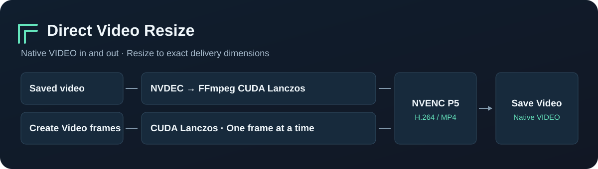

# ComfyUI 视频直缩

**二采跑大图，成片按交付尺寸输出。** 输入 ComfyUI 原生 `VIDEO`，填宽高，输出直接接 `Save Video`。适合 H3、VAE 解码或视频超分后，把高分辨率结果缩成 1080p 成片。

[English](README.md) · [测试数据与复现方法](docs/BENCHMARKS.md) · [示例工作流](workflows/resize-saved-video.json)



- **内存帧直接导出。** 接 `Create Video` 时逐帧在 CUDA 上做抗锯齿 Lanczos 缩放，然后送给 NVENC。第一次视频编码就在目标分辨率完成，省掉先把高分辨率帧编码成临时视频的时间。
- **已保存的视频走硬件处理。** 对兼容的同宽高比素材，FFmpeg 走 NVDEC 解码、CUDA Lanczos 缩放和 NVENC 编码。兼容 MP4 的音轨直接复制，帧时序透传。
- **缩放额外开销随单帧尺寸变化。** 节点复用工作缓冲并逐帧输出，避免额外堆出第二份整段浮点画面。上游 VSR 或解码节点已有的帧仍占用内存。
- **缩小后保留细线。** NVIDIA 两条路线都使用 Lanczos 和 NVENC P5。用同一份 RGB 输入比较缩放结果，CUDA Lanczos 比双线性更接近 FFmpeg 的软件 Lanczos 参考。 [对照方法与数据](docs/BENCHMARKS.md#resampling-check)

### 安装与接线

在 `ComfyUI/custom_nodes` 下克隆仓库，用运行 ComfyUI 的 Python 安装依赖，然后重启。

```sh
git clone https://github.com/YingH5938/ComfyUI-Direct-Video-Resize.git
python -m pip install -r ComfyUI-Direct-Video-Resize/requirements.txt
```

便携版用 `python_embeded/python.exe` 代替 `python`。搜索 **`Video Resize (CUDA + NVENC, Streaming)`** 或 **`DirectVideoResize`**。

| 素材 | 接法 |
| --- | --- |
| 已保存的文件 | `Load Video` → **`Video Resize`** → `Save Video` |
| 二采或解码后的内存帧 | `Create Video`（`codec=none`）→ **`Video Resize`** → `Save Video` |
| 上游节点给出文件路径 | 路径接 **`CUDA 视频缩放（文件直连）`** → `Save Video` |

起步设置用 **1920×1080、NVIDIA NVENC、quality 18**。需要更保细节时可试 14，文件一般会更大。节点按目标比例居中裁剪，宽高填偶数。末端 `Save Video` 的格式和编码设为 `auto`，兼容的 MP4 会直接保存压缩流。

### 环境要求

- 本机验证环境是 Windows、ComfyUI 0.44.0、RTX 5090。GPU 模式需要带 `h264_nvenc` 的 FFmpeg，处理文件还需要 CUDA 解码和 `scale_cuda`。需要指定 FFmpeg 时，在启动 ComfyUI 前设置 `IMAGEIO_FFMPEG_EXE`。
- **内存帧做 CUDA Lanczos 还需要 Triton**。Windows 版请选与当前 PyTorch 和 Python 匹配的 [Triton-Windows](https://github.com/woct0rdho/triton-windows)。文件路线由 FFmpeg 缩放，无需 Triton。
- 主要验证的是常规 SDR 视频和 H.264 MP4 成片。文件路线复制 MP4 兼容音轨，内存帧路线把输入音频编码成 AAC。`CPU x264` 是手动可选路线，文件用 Lanczos，内存帧用带抗锯齿的双线性缩放。
- 在 RunningHub 等托管平台使用时，平台需要安装这个节点和运行依赖。

RTX 5090 实测，**5504×3096 → 1920×1080**，240 帧、24 fps、带音频。已保存文件路线中位数 **1.00 秒**，CPU 内存帧路线 **3.04 秒**。用同一份内存帧对照，原先带两次中间编码的路线用时 **31.77 秒**，现在是 **3.03 秒**。计时覆盖缩放和编码，完整方法见 [测试报告](docs/BENCHMARKS.md)。

项目采用 [MIT 许可证](LICENSE)。
